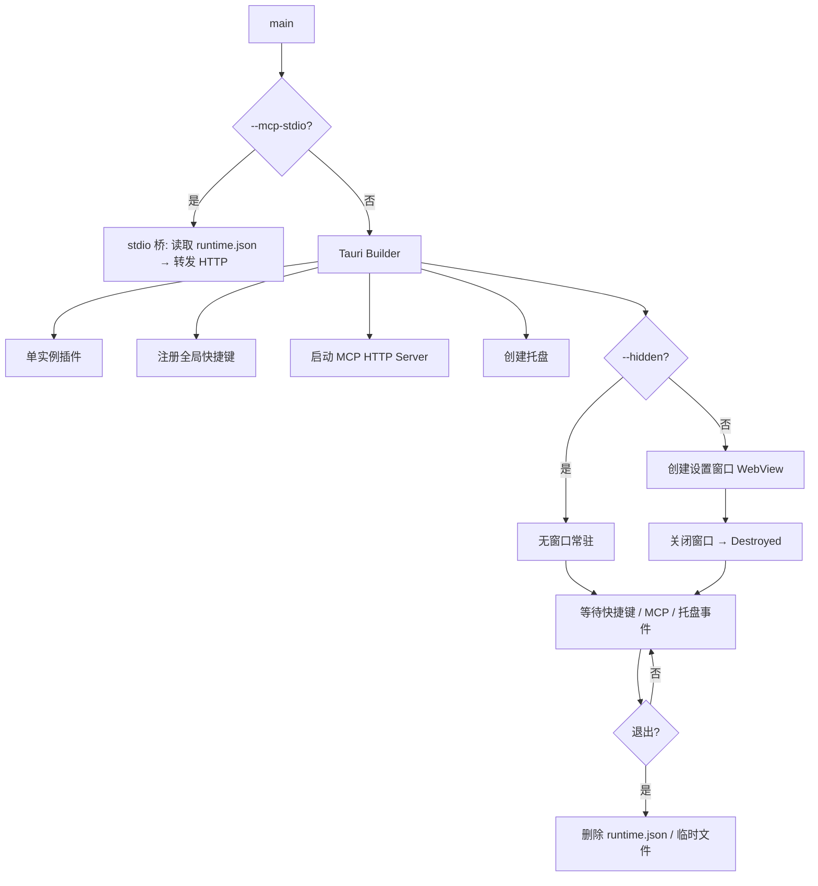
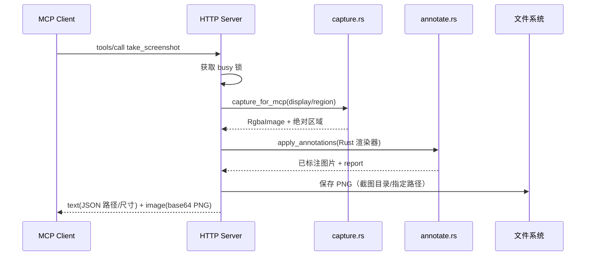
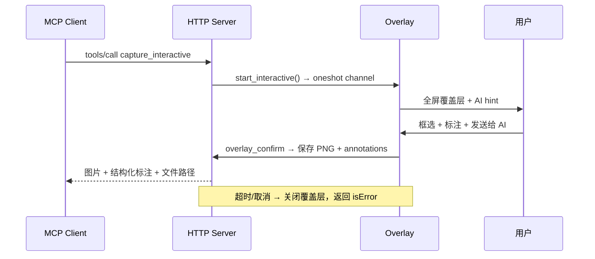

# SnapMCP 架构说明

## 1. 设计目标

| 目标 | 实现策略 |
| --- | --- |
| 包体小 | Tauri 2 + Rust；前端无 UI 框架；仅 Vue 运行时；release 启用 LTO/strip |
| 冷启动快 | 启动时不创建任何窗口；托盘进程只初始化 MCP 与快捷键 |
| 闲置内存低 | 不常驻 WebView；覆盖层/设置窗口按需创建，关闭销毁 |
| 截图快 | Rust 直接调用系统截图 API（经 xcap），不经过浏览器媒体流 |
| 标注流畅 | Canvas 绘制，坐标空间与导出图片一致，不反复升降采样 |
| AI 原生 | MCP Server 与截图状态共享同一线程内数据，自动标注在 Rust 完成 |

## 2. 模块地图

```text
┌────────────────────────────────────────────────────────────────────┐
│ Tauri 进程 (SnapMCP.exe)                                            │
│                                                                    │
│  tray.rs ────────────── 托盘菜单 / 左键打开设置                     │
│  lib.rs ─────────────── 插件、单实例、退出控制、RunEvent            │
│  commands.rs ────────── 前端 invoke 命令                            │
│  settings.rs/paths.rs ─ 配置、运行时目录、日志、runtime.json        │
│                                                                    │
│  ┌───────────── 截图 & 覆盖层 ─────────────┐                        │
│  │ capture.rs   xcap 多屏捕获/裁剪/合成    │                        │
│  │ overlay.rs   窗口创建、临时 PNG、状态机  │                        │
│  │ annotate.rs  Rust 字体 + 矢量标注渲染    │                        │
│  └─────────────────────────────────────────┘                        │
│                                                                    │
│  ┌───────────── MCP ───────────────────────┐                        │
│  │ mcp/server.rs   Axum / Streamable HTTP   │                       │
│  │ mcp/protocol.rs 双代 JSON-RPC / tools    │                       │
│  │ mcp/tools.rs   工具执行、保存、回图      │                       │
│  │ cli.rs          --mcp-stdio 转发桥       │                       │
│  └─────────────────────────────────────────┘                        │
│                                                                    │
│  WebView 窗口（按需）                                                │
│   ├─ settings (index.html)   设置 / 状态 / MCP 配置                 │
│   └─ overlay  (overlay.html) 框选 / 标注 / 人工确认                 │
└────────────────────────────────────────────────────────────────────┘
```

## 3. 启动与常驻



关键点：

- `tauri.conf.json` 的 `app.windows` 为空，因此启动时不会创建 WebView。
- `RunEvent::ExitRequested` 在非主动退出时调用 `prevent_exit`，保证关闭最后一个窗口后仍常驻托盘。
- 托盘“退出 SnapMCP”和设置页“退出”会设置 `AppState.exiting = true`，再调用 `app.exit(0)`。
- WebView 只在：
  - 用户打开设置；
  - 用户按快捷键 / MCP 调用 `capture_interactive`；
  - 时创建，并在关闭后销毁。

## 4. 两种截图流程

### 4.1 人工截图（快捷键 / 托盘）

```mermaid
sequenceDiagram
    participant U as 用户
    participant T as Tray/Shortcut
    participant O as Overlay.rs
    participant X as xcap
    participant W as WebView overlay
    participant R as Rust export

    U->>T: Ctrl/Cmd+Shift+X
    T->>O: request_human_capture()
    O->>O: busy=true; 隐藏设置窗口; sleep 140ms
    O->>X: capture_primary()
    X-->>O: RgbaImage(1920×1080)
    O->>O: 保存临时 PNG；pending_overlay
    O->>W: 创建 overlay 窗口（visible=false，全屏尺寸）
    W->>O: overlay_bootstrap
    O-->>W: imageDataUrl + 尺寸 + 显示器
    W->>W: 用户框选 → Canvas 标注
    W->>R: export_capture(action=clipboard/save/saveAs)
    R->>R: 解码前端合成 PNG → 剪贴板/文件
    W->>O: overlay_close
    O->>O: 删除临时文件；busy=false；销毁窗口
```

覆盖层不透明，而是显示冻结的屏幕截图并绘制半透明遮罩。框选区域通过 `clearRect` 露出原图，从而避免透明窗口在 Windows/macOS 上的兼容性问题。

### 4.2 AI 自动截图（MCP `take_screenshot`）



自动截图不弹窗、不需要人工确认，直接返回结果；如果用户正在截图，返回工具错误“Another screenshot is already in progress”。

### 4.3 人工确认（`capture_interactive`）



## 5. 坐标系统

这是本项目最容易出错的部分，明确分为三层：

1. **虚拟桌面物理像素**
   - `list_displays` 返回的 `x/y/width/height`。
   - MCP `take_screenshot.region` 使用这个空间。
   - 多屏合成时以虚拟桌面左上角为原点。
2. **截图图像像素**
   - 捕获后的 PNG 宽高。
   - MCP `annotations`、前端 Canvas 标注都使用这个空间。
   - 区域裁剪后，坐标相对于裁剪结果。
3. **CSS 像素 / 窗口坐标**
   - WebView 的 `clientX/clientY` 与 Canvas CSS 尺寸。
   - 覆盖层通过 `imageWidth / rect.width` 实时换算到图片像素，兼容 Windows 缩放（125%/150% 等）。

前端标注坐标始终保存在图片空间；显示时通过 Canvas transform 缩放，导出时重置 transform 并按原始分辨率生成像素，因此不会因为预览缩放而产生坐标偏差。

## 6. 标注渲染的两套实现

| 场景 | 实现 | 原因 |
| --- | --- | --- |
| 人工标注、实时预览、最终导出 | `src/lib/renderer.ts`（Canvas 2D） | 交互流畅、字体使用系统 WebFont、所见即所得 |
| MCP 自动截图 / 追加标注 | `src-tauri/src/annotate.rs`（Rust） | 无需启动 WebView，适合后台/无人值守 |

两套实现共享同一份 JSON Schema（见 `mcp/protocol.rs` 与 `lib/types.ts`）：

- 形状颜色解析支持 hex/rgb/named/alpha。
- Rust 侧使用 `ab_glyph` + 系统字体（Windows 依次尝试微软雅黑、黑体、宋体、Segoe UI；macOS 尝试苹方；Linux 尝试 Noto CJK / 文泉驿 / DejaVu），支持中文。
- Rust 手写抗锯齿粗线、圆形、三角形、圆角矩形容器，避免 imageproc 在越界/透明混合上的问题。
- 文字通过局部图层 + `draw_text_mut` 渲染，避免半透明背景覆盖字形。
- 马赛克通过“缩小 → 最近邻放大”实现，不引入额外模糊库。

视觉上两套实现可能有细微字重/箭头比例差异；对使用目的（功能标注）足够，且人工导出一定走前端渲染。

## 7. Canvas taint 与导出

覆盖层最初通过 Tauri asset protocol 加载临时 PNG，导致 Canvas 被跨域污染，`toDataURL()` 抛错。最终设计：

- `overlay_bootstrap` 直接把 PNG 编码为 `data:image/png;base64,...` 返回。
- WebView 从同源 data URL 加载，Canvas 不 taint。
- `renderComposite()` 在原始分辨率生成最终 PNG，再通过 IPC 交给 Rust 保存/写剪贴板。
- 不在 Rust 侧重放前端标注，避免两套渲染结果不一致。

代价是 bootstrap 响应包含 base64 图片（1920×1080 截图通常为几百 KB 到几 MB）；相比保证导出可用，这个开销可以接受。

## 8. MCP 传输设计

- **HTTP**：Axum 0.8，单一路由 `POST /mcp`；`application/json` 响应，无 SSE。
- **stdio 桥**：`--mcp-stdio` 模式不初始化 Tauri，读取 stdin 的逐行 JSON-RPC，转发到 HTTP，再把响应写回 stdout。stderr 只用于诊断。
- **自动启动**：stdio 桥找不到运行的实例时，以 `--hidden` 启动同目录可执行文件，并轮询 `runtime.json` / `/health`。
- **安全**：
  - 仅绑定 `127.0.0.1`。
  - 校验 `Origin`：仅允许 localhost / 127.0.0.1 / `tauri.localhost` / `asset.localhost` 等本地源；无 Origin 的 CLI 客户端放行。
  - 可选 token。
  - 不启用 Tauri asset 协议，避免把任意本地文件暴露给 WebView。
- **并发**：一个 `AtomicBool` 截图占用标志；同时发起截图会立即返回错误。自动截图使用 `BusyGuard` RAII 释放。
- **交互式截图**：`oneshot` 通道把覆盖层结果送回工具调用；超时后关闭窗口并发送取消。覆盖层 Destroyed 事件会清理临时文件与悬挂通道。

## 9. 失败与清理

- 覆盖层临时文件：`%TEMP%\snapmcp\captures\cap_*.png`。
- `overlay_close` / `overlay_cancel` / `WindowEvent::Destroyed` 都会：
  - 删除临时文件；
  - 清空 `pending_overlay`；
  - 向等待中的 MCP 请求发送取消；
  - 释放 busy 标志。
- 启动时不会清理历史临时文件；操作系统会定期回收 `%TEMP%`。如需严格清理，可在未来加启动清扫（>24h 的文件）。
- `runtime.json` 在正常退出时删除；崩溃后残留由下次启动覆盖。stdio 桥也会通过端口扫描自愈。
- 重复启动：单实例插件将第二次启动转为“打开设置/触发截图”消息；`--mcp-stdio` 在 Tauri 初始化前处理，因此不会被单实例拦截。

## 10. 性能取舍

1. **无窗口常驻**：牺牲首次唤起覆盖层的 1–2 秒 WebView2 冷启动，换取 <30 MB 闲置内存。
2. **data URL 图片传输**：牺牲 IPC 带宽，换取 Canvas 可导出。
3. **前端主导出**：牺牲“纯 Rust 导出”的一致性，换取真正的 WYSIWYG。
4. **Rust 自动标注**：牺牲部分字体/排版精细度，换取无 WebView 的后台截图能力。
5. **单主屏交互覆盖层**：多显示器交互需要多窗口同步，复杂度高；MCP 侧已支持任意显示器与虚拟桌面裁剪。

## 11. 未来可扩展方向

- 标注选中、拖动、缩放与图层控制
- 多显示器独立覆盖层
- 截图完成后直接“钉在桌面”（置顶贴图）
- OCR / 自动检测 UI 元素并生成带坐标的标注建议
- i18n（当前主要中文）
- macOS 屏幕录制授权引导与自动检测
- Linux Wayland 截图后端
- 可选的 SSE 兼容层（供旧版 HTTP MCP 客户端）
